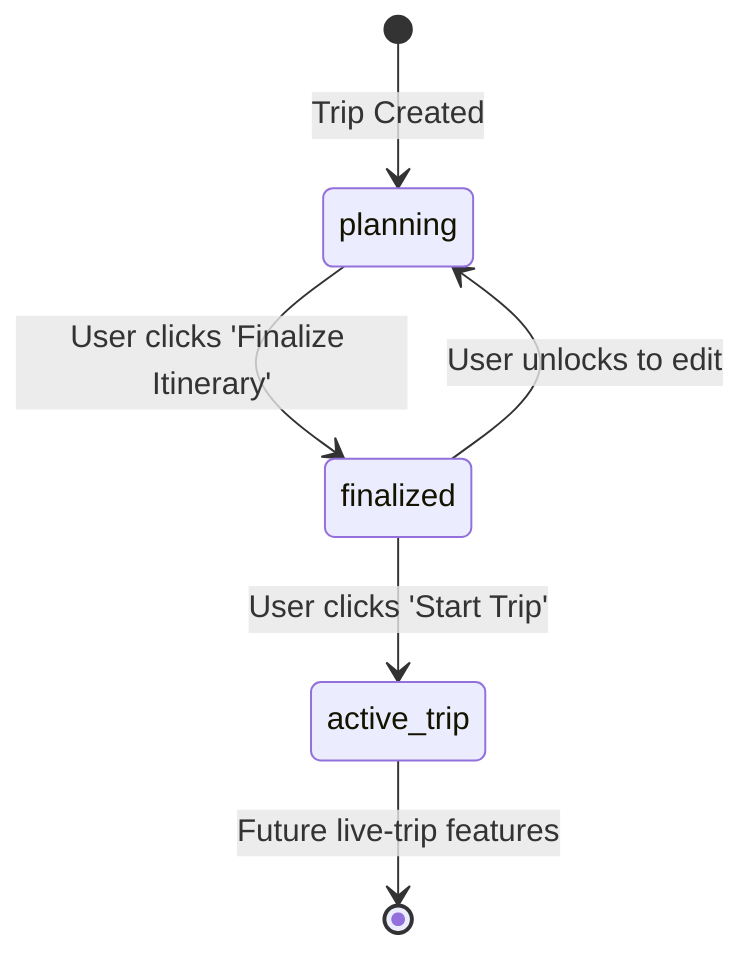

# Pre-Trip Itinerary Workflow & Integration Guide

**Owner:** Person C (Integrator)  
**Modules:** `itinerary_editor` (`app/modules/trip_actions.py`, `static/modules/itinerary_editor.js`)  
**Companion Route:** `/api/trip-actions`  

---

## 1. End-to-End Pre-Trip Workflow Architecture

```
[1. User Profile Setup]
         │ (Interests, Climate, Budget Tier, Companions)
         ▼
[2. Destination Recommendation & Ranking]
         │ (Presents multiple Indian and global options)
         ▼
[3. Destination Selection & Trip Creation]
         │ (User selects destination e.g. Manali, Goa, Kyoto + sets dates)
         ▼
[4. Timed Day-by-Day Itinerary Generation]
         │ (Scheduled slots: Sightseeing + Travel Buffer + Meals + Rest Break)
         ▼
[5. Interactive Customization & RL Swapping]
         │ (LinUCB bandit serves alternatives for slots; Swap or Remove)
         ▼
[6. "Finalize Itinerary" Button]
         │ (Locks plan in database: status -> 'finalized')
         ▼
[7. "Start Trip" Button]
         │ (Activates live journey mode: status -> 'active_trip')
         ▼
[Future Work: Live Tracking & On-Trip Re-planning]
```

---

## 2. Realistic Schedule Composition (Transit, Meals, and Rest)

Unlike naive systems that schedule 8 back-to-back hours of walking, the Timed Itinerary Engine implements human-centric travel pacing:

1. **Morning Exploration Block (09:30 AM – 11:30 AM):**
   - High-energy cultural, nature, or historical attraction.
2. **Transit Buffer (11:30 AM – 12:15 PM):**
   - Explicit travel time (30–45 minutes) based on local auto-rickshaw, cab, or metro transfers. Prevents impossible teleports between distant attractions.
3. **Dining / Meal Time (12:15 PM – 01:45 PM):**
   - Dedicated 90-minute lunch slot highlighting regional food specialties and local cafe hopping.
4. **Afternoon Sightseeing Block (02:00 PM – 04:30 PM):**
   - Secondary activity aligned with trip pace and walking tolerance.
5. **Rest & Relaxation Time (04:30 PM – 06:00 PM):**
   - Mandatory downtime for hotel tea, foot soak, or quiet scenic rest before evening events.
6. **Evening Activity / Dinner (06:30 PM – 08:30 PM):**
   - Night markets, cultural temple aarti, or fine dinner.

---

## 3. Interactive Customization & LinUCB Alternative Swapping

When the traveller reviews their schedule:
- **"💡 Suggest Alternatives" Button:**
  Calls `GET /api/itinerary/alternatives/{itinerary_id}/{activity_id}`.
  The **LinUCB contextual bandit** computes predicted rewards $x^T \hat{\theta}_a + \alpha \sqrt{x^T A_a^{-1} x}$ for non-conflicting activities in the catalogue and returns the top 3 alternatives.
- **"Swap with this activity":**
  Calls `POST /api/trip-actions/{trip_id}/activity/{activity_id}/swap`.
  Replaces the slot in SQLite and sends a `MODIFY` feedback signal to the bandit policy (penalizing the replaced item $-0.4$ and rewarding the accepted alternative $+1.0$).
- **"✕ Remove":**
  Removes the item from the schedule and sends a `REJECT` signal to the bandit.

---

## 4. Trip Finalization & 'Start Trip' Activation

The trip lifecycle is explicitly tracked in SQLite:



### API Endpoints:
- `POST /api/trip-actions/{trip_id}/finalize?user_id={user_id}`:
  Sets `trips.status = 'finalized'` and timestamps `finalized_at`. Locks editing in the UI.
- `POST /api/trip-actions/{trip_id}/start?user_id={user_id}`:
  Sets `trips.status = 'active_trip'` and timestamps `started_at`. Triggers a green active pulsing badge and notifies the traveller that their trip has begun.

---

## 5. Verification & Test Evidence

Run tests using pytest:
```bash
python -m pytest tests/test_trip_actions.py -v
```

Real execution output:
```text
tests/test_trip_actions.py::test_timed_itinerary_view PASSED             [ 20%]
tests/test_trip_actions.py::test_finalize_trip_lifecycle PASSED          [ 40%]
tests/test_trip_actions.py::test_start_trip_activation PASSED            [ 60%]
tests/test_trip_actions.py::test_activity_swap PASSED                    [ 80%]
tests/test_trip_actions.py::test_activity_remove PASSED                  [100%]
5 passed in 1.65s
```

Combined project test suite:
```bash
python -m pytest tests -q
.......................                                                  [100%]
23 passed in 5.86s
```
